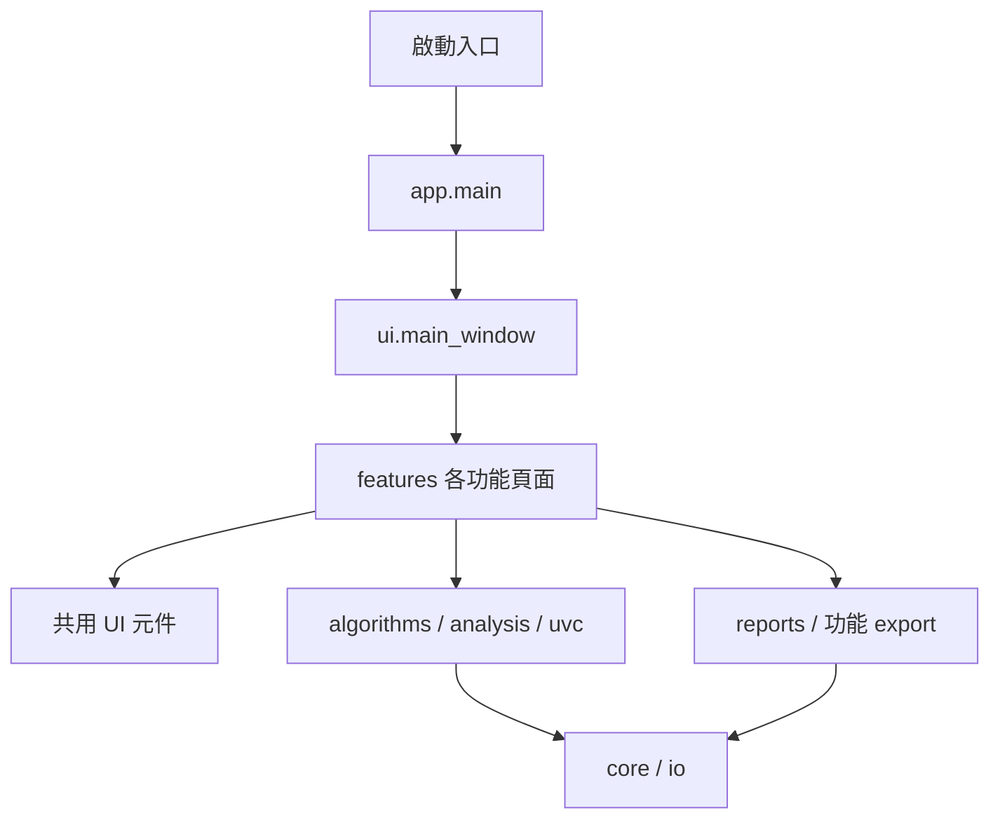

# 模組架構與維護指引

此次整理把原本單一檔案中的實作移入 `thermal_toolkit`。演算法參數、功能名稱、頁面順序與 Save 行為沿用重構前版本。

## 啟動與主視窗

`python main.py` 是直接啟動方式；`python -m thermal_toolkit` 則透過 `__main__.py` 啟動相同的 `app.main()`。原有的啟動檔已改名為 `main.py`。

`ui/main_window.py` 的 `ThermalRawToolkit` 負責共用狀態、頁面導覽、主畫面配置、輸出資料夾和關閉生命週期。功能操作以各頁面的 Mixin 組合進主視窗，因此原有 Qt signal、`self` 狀態與 callback 名稱保持一致。

每個功能的 `build_*_page()` 建立其控制項、signal 連線並加入 `self.stack`；`_create_pages()` 依原有順序呼叫這 12 個方法。新增頁面時，需同步調整功能清單、說明、預覽配置、建立順序及操作入口，避免現有索引失配。

## 功能檔案對照

| 功能 | 主要入口 | 其他實作 |
|---|---|---|
| Single Image Statistics | `features/image_statistics/page.py` | `analysis/statistics.py`、`reports/histogram.py` |
| Average RAW Folder | `features/average_raw/page.py` | `io/raw.py` |
| NUC Calculate | `features/nuc/calculation_page.py` | `calibration.py` |
| NUC_Analyze | `features/nuc/analysis_page.py` | `analysis.py`、`definitions.py`、`export.py` |
| High / Low Analyzer | `features/high_low/page.py` | `algorithms/mapping.py` |
| Temporal Drift Analyzer | `features/temporal_drift/page.py` | `analysis.py`、`worker.py`、`export.py`、`help_text.py` |
| BPR Bad Pixel Marking | `features/bpr/page.py` | `coordinates.py`、`render.py` |
| Dual Image Compare | `features/dual_image/page.py` | `analysis/quality/`、`ui/preview_windows.py` |
| Image Algorithm Compare | `features/image_algorithm/page.py` | `statistics.py`、`algorithms/`、`ui/pipeline_editor.py` |
| Single UVC Statistic | `features/single_uvc/page.py` | `recording.py`、`uvc/` |
| Dual UVC Compare | `features/dual_uvc/page.py` | `recording.py`、`uvc/` |
| UVC Algorithm Compare | `features/uvc_algorithm/page.py` | `recording.py`、`uvc/processing.py`、`algorithms/` |

表格中的短檔名表示位於該功能資料夾內。

## 共用模組

- `core/version.py`：`APP_VERSION` 與 `APP_TITLE`。
- `core/settings.py`：設定預設值、驗證、載入／儲存及品質權重套用。
- `core/constants.py`：共用格式、相機、品質與顯示常數。活動品質權重字典由此模組統一持有。
- `core/paths.py`：原始碼／EXE 根目錄、內附資源、設定檔和結果目錄位置。
- `algorithms/parameters.py`：演算法選項、預設值和 `AlgorithmStage`。
- `algorithms/tone_mapping.py`：原始 DN 到 8-bit 的映射入口。
- `algorithms/enhancement.py`、`pipeline.py`：Image／UVC 共用處理入口與管線執行。
- `analysis/quality/`：品質分析拆為量測輔助、空間品質、UVC 時間品質及共用介面。
- `ui/widgets/`：輸入控制項、預覽、可收合群組等共用元件。
- `ui/quality_controls.py`、`image_analysis.py`、`preview_windows.py`：主視窗共用的品質顯示、影像統計與比較視窗流程。
- `uvc/`：相機與影格工作執行緒。頁面組合這些能力，不複製擷取或處理迴圈。

## 依賴與修改原則

內部模組直接匯入需要的名稱，不透過 `main` 或 `thermal_toolkit.api` 反向匯入。`api.py` 只提供舊版呼叫端相容名稱，本身不放實作。測試若需要替換相機列舉、設定載入或背景分析，應 mock 實際使用該名稱的模組，而不是相容入口。

保留 Image／UVC 共用的演算法模組；修改預設值時，仍需一起檢查 Pipeline 編輯器、reset／load 行為及兩種比較頁面。

預覽及分析流程只更新記憶體與畫面。原本採 Save 才輸出的功能仍由 Save handler 建立結果目錄並呼叫 export；Temporal Drift 的 Save 使用已顯示的分析快取。

## 路徑與打包

設定檔位於 `docs/toolkit_settings.json`，讀取與儲存皆使用此路徑；打包後使用 EXE 目錄下的相同相對路徑。設定檔不存在時使用預設值，儲存時會自動建立 `docs/`。

移動 Python 檔案後，`core/paths.py` 仍將來源根目錄解析為套件上一層。設定檔、品質說明、預設結果資料夾不會改到子套件內，也不會受啟動時的工作目錄影響。

品質說明位於 `html/quality_score_guide.html`。凍結執行時，設定與結果以 EXE 目錄為準；說明資源優先使用 EXE 目錄下的 `html/quality_score_guide.html`，再讀 `_MEIPASS/html/quality_score_guide.html`。目前工作目錄未保留 spec；日後打包以 `main.py` 為入口，並在 `datas` 加入 `('html', 'html')`。套件使用靜態匯入，沒有以 `exec` 拼接來源或執行期掃描來載入功能。

## 驗證範圍

重構過程比對了原始函式／類別／方法的語法樹，以及拆開前後的頁面建立敘述順序；資源根目錄解析是隨檔案位置調整的部分。

`tests/test_structure.py` 檢查模組載入、相容入口、來源／凍結資源路徑、共用品質權重、12 個頁面與演算法／UVC 處理整合。`tests/fixtures/refactor_algorithm_outputs.json` 保存重構前 18 組演算法輸出摘要。`tests/test_temporal_drift.py` 檢查背景分析、輸入失效、關閉工作執行緒及 Save 圖表流程。

這些是主機與離屏介面驗證，不涵蓋實體相機串流、錄影長時間測試或 EXE 發行驗收。
